# Architecture

How Meneer Henk is built. The spec in [docs/SPEC.md](docs/SPEC.md) says what he
does and promises; this file says how the code keeps those promises. The README
says how to configure and run him. Section numbers (§3.2 and so on) refer to the
spec.

This version covers code review (§3) and issue planning (§4) on GitHub and
GitLab. Discord (§5), email (§6) and voice (§5.5) are later passes; they appear
dashed in the first diagram so the shape of the whole is visible.

The diagrams are Mermaid, which GitHub renders in place.

## 1. System context

Henk is one process that is an MCP *client*. The platforms are reached through
external MCP servers started as child processes; models are reached over HTTPS.
Nothing a model says reaches a platform without passing through Henk's own code.

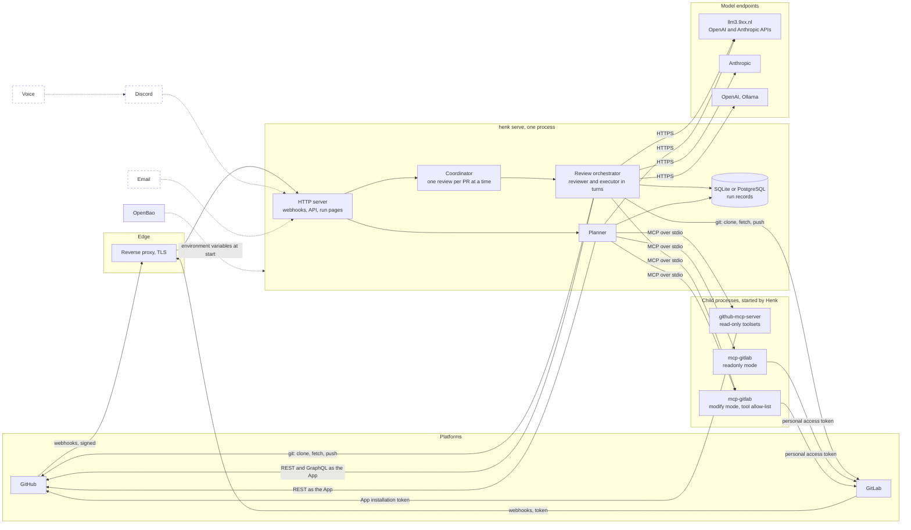

What to notice: two sessions per platform. The read-only session is the only
one a model can reach, and even that only through the guard of section 4. The
write-mode session (GitLab) and the App REST client (GitHub) are driven by
Henk's code with arguments it constructs. A review's models reach no MCP
session at all: they read the diff Henk fetched and a workspace at the pull
request's head, and only Henk's code pushes (section 3).

## 2. Crates

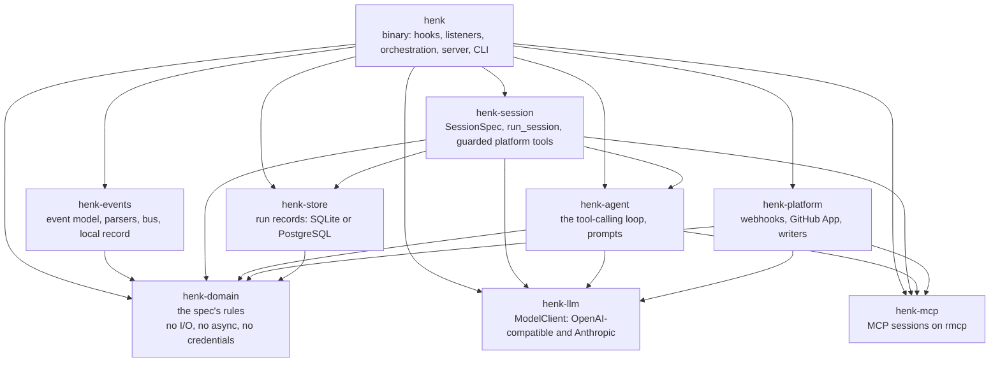

| Crate | Modules | Depends on |
|---|---|---|
| `henk-domain` | `identity`, `allowlist`, `review`, `review_loop`, `role`, `marker`, `scope`, `queue`, `plan`, `plan_review`, `run`, `text`, `skill`, `workspace`, `path`, `push`, `commit`, `discord`, `mail` | serde, thiserror, serde_json |
| `henk-llm` | `types`, `client`, `openai`, `responses`, `anthropic`, `http`, `schema`, `chatgpt`, `testing` | reqwest with rustls (ring) |
| `henk-mcp` | `session`, `config`, `names`, `testing` | rmcp 3.5 (client features only) |
| `henk-agent` | `agent`, `tool`, `mcp_tools`, `prompts` and `prompts/*.md` | domain, llm, mcp |
| `henk-session` | `lib`: `SessionSpec`, `run_session`, `platform_tools` | domain, llm, mcp, agent, store |
| `henk-events` | `event`, `github`, `gitlab`, `bus` | domain, tokio |
| `henk-platform` | `webhook`, `writer`, `push`, `issue`, `github/{app,api,writer,push,issues}`, `gitlab/{writer,push,issues}` | domain, llm, mcp, ring, hmac |
| `henk-store` | `store` (the async `RunStore` trait), `sqlite`, `postgres`, `migrations/{sqlite,postgres}/`, `db/` (the new `Store`), `migrator/` | rusqlite (bundled), tokio-postgres with deadpool, sea-orm (the migrator), rustls (ring) |
| `henk` | `main`, `config`, `app`, `hooks/{github,gitlab,api}`, `listeners/{filter,review,mention,plan,execute}`, `recorder`, `review`, `review_loop`, `loop_tools`, `diff_tools`, `code_tools`, `edit_tools`, `workspace`, `git`, `push`, `plan`, `plan_tools`, `plan_pairing`, `plan_review_tools`, `execute`, `execute_tools`, `issue_runs`, `skills`, `skill_tools`, `web_fetch`, `coordinator`, `server`, `pages`, `dashboard/{auth,session,api,app}`, `urls`, `doctor`, `ids` | all of the above, axum |

`henk-platform` depends on `henk-llm` for one function, `ensure_tls_provider`,
so every HTTPS client in the process shares the same rustls setup.

`henk-store` has two implementations today. The decision to replace them with
one over sea-orm, and why, is in
[`docs/decisions/0001-run-store-layer.md`](docs/decisions/0001-run-store-layer.md)
(#598). The schema of the one implementation exists already, in
`crates/henk-store/src/migrator/` (#604): a single sequence of steps for SQLite
and PostgreSQL, `m001_baseline.rs` onwards, which also adopts a database the
old migrations made; its README says how to add a step. Until the old stores
are removed (#608) they still run `migrations/{sqlite,postgres}/`, so a schema
change is written in both places.

The methods are moving to the new layer in groups (#605 to #607): the type
`Store` in `crates/henk-store/src/db/` has them once, for both databases,
with what differs between the two (the time, the day of a time, the order of a
table without a key of its own) in one small `dialect.rs`. Every group of
methods is there now: the runs and stages (`runs.rs`, `stages.rs`), the
sessions, rounds, transcripts and timeline (`sessions.rs`, `timeline.rs`), and
the findings, drafts, tool calls, inbound events and statistics (`findings.rs`,
`calls.rs`, `inbound.rs`, `stats.rs`).
`SqliteStore` and `PgStore` still implement `RunStore` and hand the moved
methods to a `Store` that opens the same database, so a database is shared by
two libraries until the old code is removed (#608). `SqliteStore::in_memory` is a
temporary file for that time, because an in-memory database cannot be opened
by both.

TLS to PostgreSQL is checked, not only encrypted. sqlx reads `sslmode` like
`psql`, where `prefer` accepts any certificate, so `Store` raises `require` and
`verify-ca` to `verify-full` and refuses `prefer`, `allow` and a URL with no
`sslmode` at connect (`refuse_unverified_tls`). The old driver verified under
`prefer`; refusing is the only way not to downgrade that silently. A server
without TLS needs `sslmode=disable` in its URL.

## 3. A review, end to end

A `synchronize` webhook from GitHub, start to finish. The GitLab path is the
same with the writer swapped (section 10 lists the differences). A review is
the reviewer↔executor loop (#284, #309): a reviewer model reviews the pull
request, an executor model fixes what holds, and Henk pushes the fix to the pull
request's branch, round after round, until the reviewer finds nothing more or
a limit stops it.

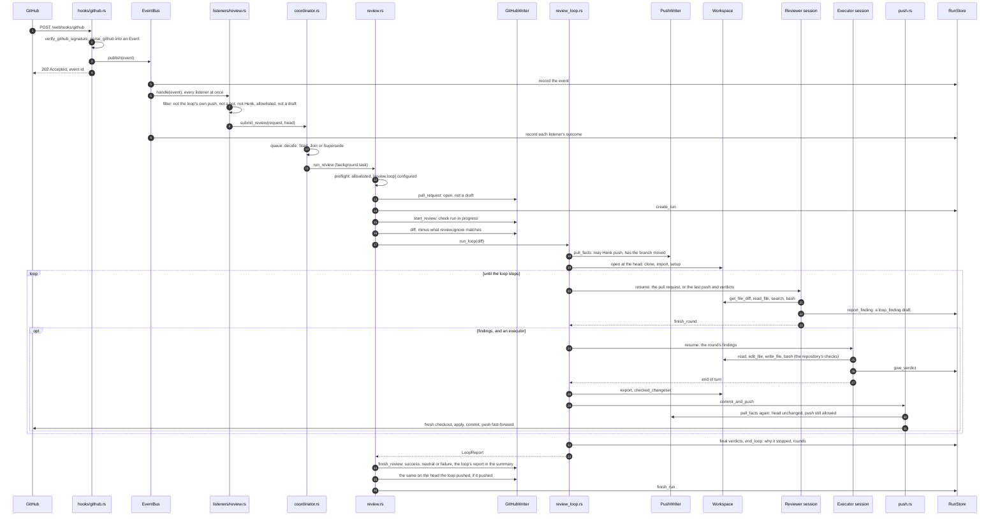

`run_review` refuses before it records a run when the repository is not on
the allowlist, when no `[review.loop]` is configured ("reviews are off"), or
when the pull request is closed or a draft. The diff is fetched once per
review (`PlatformWriter::diff`, parsed by `henk_domain::diff`, minus the files
`review.ignore` matches, see `henk_domain::ignore`). A diff with no change
at all fails the review; one whose every file is ignored completes it with
nothing to review and no loop.

`review_loop::run_loop` reads the pull request's facts through the
`PushWriter` (`henk_platform::push`). When Henk may not push to it (a fork,
the default or a protected branch, `henk_domain::push::push_refusal`) or its branch moved after the review was
queued, the reviewer reviews alone (#307): one round at the reviewed commit,
fetched by its sha, no executor, nothing pushed, and its findings stand in the
check. Otherwise the loop clones the branch at its head. Either way it opens
one workspace, set up as the repository's profile says ("The workspace",
below), and
both sessions take turns in it: after a push the workspace holds the new
head, so nothing has to move.

The reviewer and the executor are each a `henk_session::ResumableSession`: every
round resumes its own conversation, and a session's row, timeline and
transcript cover all its rounds. The reviewer reads the diff per file with
line numbers (`diff_tools.rs`) and the code in the workspace
(`code_tools.rs`), and hands over what it found with `report_finding`, then
`finish_round`. The executor gets the round's findings as data, edits with
the edit tools (`edit_tools.rs`: `edit_file`, `write_file`, paths parsed by
`henk_domain::path`), runs the repository's own checks with `bash` on a
backend apart from Henk (#396), and gives each finding
one verdict with `give_verdict`:
fixed, rejected or won't fix. Findings and verdicts live in the
`henk_domain::review_loop::Ledger` and go on the run's drafts with the kind
`loop_finding` (section 8); nothing reaches the pull request but the push.
A session that stops short of `finish_round` or a verdict is nudged at most
twice (`loop_tools.rs`), then what it left is settled for it.

What the executor changed is checked before it is pushed (§3.5):
`checked_changeset` refuses `.git`, escapes, links, submodules and too many
files. Henk runs no checks of his own; the executor ran the repository's,
and the pull request's CI is the final word. `push.rs`
then applies the changeset to a fresh checkout that nothing ran in, commits
it as Henk, as the commits the executor proposed with `propose_commits`
once `henk_domain::commit::planned_commits` takes them and
`finding_refusal` finds no finding id of the run in them (#585), or as one
"Fix review findings" commit (#400), and pushes them as one
fast-forward, after
reading the branch again: a head that moved, or a branch Henk may no longer
push to, refuses the push ("The push", below). Every commit is recorded in
`App::own_pushes` before it leaves, so the webhook about it starts no other
review. The reviewer's next message carries the round's patch and the
executor's verdicts; a rejection may be contested once, with new evidence.

The loop stops (`henk_domain::review_loop::LoopStop`) when a round has no new
findings (converged), at `max_rounds`, when a finding repeats one that was
fixed, when the reviewer alone has had its round, when a push is refused, when the reviewer changed its
workspace, when a session fails or runs out of time (per round its role's
`timeout_secs`, for the whole loop `run_timeout_secs`, #286), or on a
cancel. Every finding then gets one final verdict; one left without is
`unsettled`. The first four stops end well and the review completes. A
cancel ends it the way its token says: cancelled, superseded or interrupted
(section 5). Every other stop is a failure of Henk, not of the code (§3.3). The run records why
it stopped and after how many rounds (`RunStore::end_loop`), and the check's
summary ends with the loop's report: rounds, commits pushed, why it stopped
and the findings that still stand (unsettled or won't fix). Nothing is
posted on the pull request; `finish_checks` also reports the outcome on the
last commit the loop pushed, the pull request's new head.

A run's stages are requested, queued, started, diff, checkout, rounds (the
loop's rounds), push, publish (skipped: a loop posts nothing) and done.
Reviews from before #324 have a lanes stage where rounds is, and runs from
before #309 also a fact_check stage.

Each session's conversation is kept under a size budget. Within a round old
tool results are stubbed (`henk_agent::compact`); the diff a session reads
is stubbed last. Stubbing edits earlier turns, and current Claude models
refuse a thinking block replayed after its history changed, so a compaction
that stubs anything also drops every thinking block. An edit also restarts
the provider's prefix cache, so once over budget compaction stubs down to a
low-water mark (75% of the budget): the history then stays append-only for
several turns between edits. Between rounds, a conversation over budget
drops every round but the last and starts with a summary of the findings,
their verdicts and the commits pushed (`ResumableSession::compact_rounds`,
#286). On an Anthropic model with `prompt_cache` (the default), the system
prompt and the end of the conversation carry a cache marker, so each turn
reads what the last one wrote; the run timeline records how much of the
prompt came from the cache.

The warm-cache rule of a pairing (#321, #330): within a pairing each role's
conversation is append-only, with a fixed system prompt and tool list, and
each resume adds only the other's update, so its next request starts with
its last one byte for byte (`henk_llm::testing::assert_resumed_with_only_the_update`
holds the loop and the plan pairing to it). Both kinds of compaction are a
last resort, and each is a `warn` event on the run: the agent's stubbing
(`AgentEvent::Compacted`) and the dropping of rounds (`RoundsDropped`). The
cache's lifetime is per request (`CompletionRequest::cache_ttl`, set from
`AgentConfig`): a role whose partner's round may last longer than 5 minutes
(`henk_session::cache_ttl_for`) asks for the 1-hour cache on both markers,
so a longer one never follows a shorter. A new stage (planning, execution,
review) starts fresh sessions; no cache is carried between stages. Each
session's row keeps its cache reads and writes beside its tokens in.

### The workspace

The models' tools talk only to a `Workspace` (`crates/henk/src/workspace`);
the backend is a configuration choice (`[workspace]`, per repository
through profiles): `host`, or `ssh` to a sandbox host where each workspace
is a throwaway user, made and removed by a script Henk sends with every
request as root (`workspace/sandbox.sh`; nothing is installed there), or
`kubernetes`, a Pod per workspace in a sandbox namespace, where Henk runs
the same script through `pods/exec` in its single-user mode and the Pod is
the boundary (`workspace/kubernetes.rs`; both on `workspace/remote.rs`).
On the `host` and `ssh` backends the record of changes is a git directory
outside the tree that nothing a check runs can write, `HOME` is outside the
tree, and `.git` (the `ssh` backend leaves the checkout's own in the tree
for the workspace's commands) is never something a tool reads or the
changeset carries. What is pushed is never the tree the checks ran in, only
the checked changeset applied to a fresh checkout. Every backend passes the
same contract tests (`workspace/contract.rs`).

A review with files to review opens one workspace, whatever the profile's
`review` says (#284): the loop's, at the pull request's head, through the
setup stage (`workspace/setup.rs`: the toolchain, `mise` in its safe mode,
then the profile's `setup` steps), with every command recorded on the run
(`workspace/traced.rs`). The reviewer sees it through
`workspace::never_exported`, which refuses `export`, so nothing the
reviewer does there can become a commit. The executor works in the same
workspace unwrapped: its changes are exported, checked and pushed by
`push.rs` from a fresh checkout. The code tools on a workspace
(`list_files`, `read_file`, `search`) are written once in `code_tools.rs` and
shared by the loop's reviewer and executor and the planner
(`plan_workspace.rs` opens the planner's workspace); the executor's edit
tools are in `edit_tools.rs`. `bash` is there for the reviewer, the
executor and the planner on a backend where the model may run commands
(`BackendKind::runs_model_commands`: not the host). A `search` pattern is
checked in Henk (`workspace::Pattern`) in the syntax Rust's regex and PCRE
read alike, since the host backend matches with the one and the `ssh`
backend with `grep -P`.

### The push

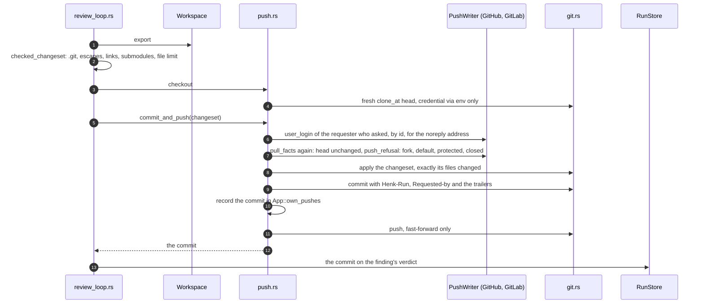

`Pusher::commit_and_push` takes where the push goes, a `PushTo`:
`PushTo::Pull` is the loop's, guarded as above; `PushTo::NewBranch` is an
execute run's (section 7b): the branch must start with `[execution]
branch_prefix`, must not be the default branch and must not exist on the
remote (`Checkout::remote_has_branch`), and the push of the new ref is never
forced. The caller passes the commits, `PlannedCommit`s that each name
their paths (`Checkout::commit_paths` stages only those): the executor's,
when `planned_commits` takes them, or else one commit, "Fix review
findings" for the loop and "Resolve #N: <title>" for an execute
run. Henk writes every trailer block; `proposal_refusal` refuses a body
line shaped like a trailer, and `finding_refusal` a subject or body that
names a finding of the run, whose ids mean nothing outside it (#585).
`ProposeCommits` applies it when the executor proposes, so it rewords in the
same round, and `Rounds::round_commits` again where the commits are made.

The rules of the changeset are pure functions in `henk-domain`:
`henk_domain::workspace::changeset_refusal` (`.git`, escapes, links,
submodules, `max_changed_files`), `henk_domain::path` (a path that stays in
the repository), `henk_domain::push::push_refusal` (closed, a fork, the
default branch, a protected branch) and `henk_domain::commit` (who the
commit is by, who it credits, the message and its trailers). `push.rs` (`Pusher`) is the one place that
commits and pushes; git gets the platform credential through its
environment only, never argv, a log or a model. Every refusal happens
before the push, and a refused push stops the loop with what was pushed
before it standing.

## 4. Where a tool call goes

The most important picture in this file. A model never receives a credential
or a tool that writes to a platform. What it receives is a list of tool names;
every call goes through Henk's dispatcher, and every MCP call through the
guard. A review's sessions get no MCP tools: the reviewer reads the diff and
its workspace, and the executor edits the workspace, which only Henk's code turns
into a commit (section 3).

Each session's tools are built once, when the session starts, and cut to
what its role grants (`crates/henk/src/roles.rs`, `grant`). The roles and
their ceilings are a pure rule in `crates/henk-domain/src/role.rs`: only
the executor edits, the handoff tools belong to their side of the pair,
the tracker tools are the planner's, and the MCP read tools are the
planner's and the reviewer's, who reviews plans too (#328); a pull
request's reviewer is still built without them. A set built
above its role's ceiling is a bug that tests stop on. The tool list never
changes while a session runs, so a resumed round keeps the cached prompt
prefix.

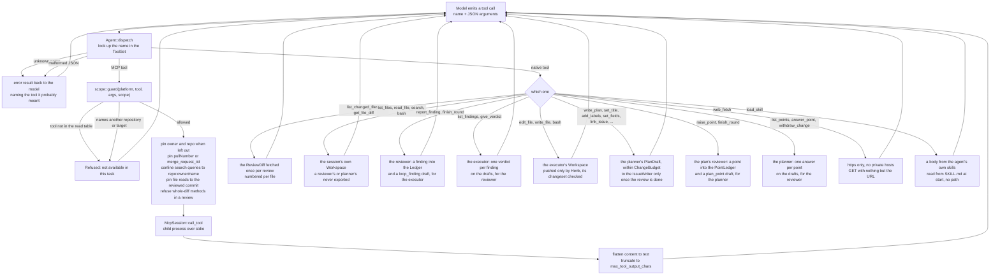

The guard table lives in `crates/henk-domain/src/scope.rs`. It is a constant
list per platform of read tools and the arguments each one gets pinned. A
value the model gives that names another repository, pull request or search
scope is refused with the reason, never swapped for the right one: a silent
swap answers a question the model did not ask. A tool
that is not in the table does not exist as far as the model is concerned, and
`henk mcp probe` shows which of a server's tools the table exposes. The server
itself is also started restricted (`GITHUB_READ_ONLY=1`, `GITLAB_PERMISSION_MODE=readonly`),
so the guard is the second fence, not the only one.

## 5. Review lifecycle and overlap

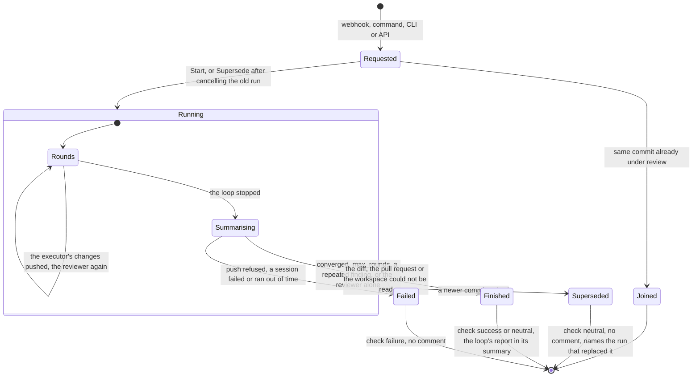

The decision between Start, Join and Supersede is the pure function
`henk_domain::queue::decide`; the coordinator applies it under a lock and
cancels the superseded run's token, telling it which run replaced it; the
old run ends `superseded` with that run's id (#231). A loop that already
pushed when it was cancelled or superseded leaves its commits on the branch;
the check on the pushed head reports how the review ended. On GitHub,
`Finished` with no finding left standing concludes the check `success`, with
findings that stand (unsettled or won't fix) or a loop stopped at
`max_rounds` `neutral`, and only `Failed` concludes `failure`, which is
Henk's failure, not the code's (§3.3).
On GitLab the commit status is always `success` with the count in its
description, because a status must never block a pipeline (§8.2).

A restart does not lose a review (#160). A shutdown ends a running review
`failed` with the error `interrupted` and closes its check as "Review
interrupted."; a review still waiting for a slot gets a run recorded the
same way. A run a dead process left `running` is closed by the reaper
(`liveness.rs`) with `interrupted: the process ended`. On start, after the
reaper's first pass, `resume.rs` reads the newest review of each pull
request started in the last 24 hours (`RunStore::latest_reviews`) and, for
each that ended interrupted, publishes a `ReviewRequested` event with the
source `resume` naming that run. The review listener handles it like a
request from the API: the allowlist and a closed pull request refuse it,
and the review is of the current head, with the trigger "resumed after
interrupted run r-...". It gets its own check; the interrupted one stays
closed. Before it publishes, the resumer claims the resume in the store
(`RunStore::claim_resume`): one conditional write changes the interrupted
run's error to say it was resumed, so of two processes on one database
that read the same run, one resumes it. A resume whose pull request could
not be read gives the claim back (`resume::release`), so a later pass or
start tries again; a refusal keeps it. The resumed run is the newer run of its pull request, so a restart
loop resumes each pull request at most once per start and never the same
run twice. One more resume follows the first reaper pass a staleness window
(three minutes) after start, which is the first that can reap a run a
process left that died just before this start; after that the periodic
passes reap only. A resumed review that the reaper closed is not resumed
again (`ReviewTrigger::resumed_from` reads its trigger back): its process
died while it ran, and a review that takes Henk down would otherwise come
back on every start. One a shutdown stopped is resumed. Once Henk is told
to stop, the resumer asks for nothing more: its own reviews are ending
interrupted then. Plans are not resumed.

## 6. Hooks, events and listeners

In serve mode nothing calls an orchestrator directly. A hook turns what it
receives into an `Event` and publishes it; the bus records the event, hands it
to every listener at once, and records what each listener did. Listeners never
see each other; the one rule that used to be implicit in an if/else chain,
that a review command is a command and not a mention, is now a test.

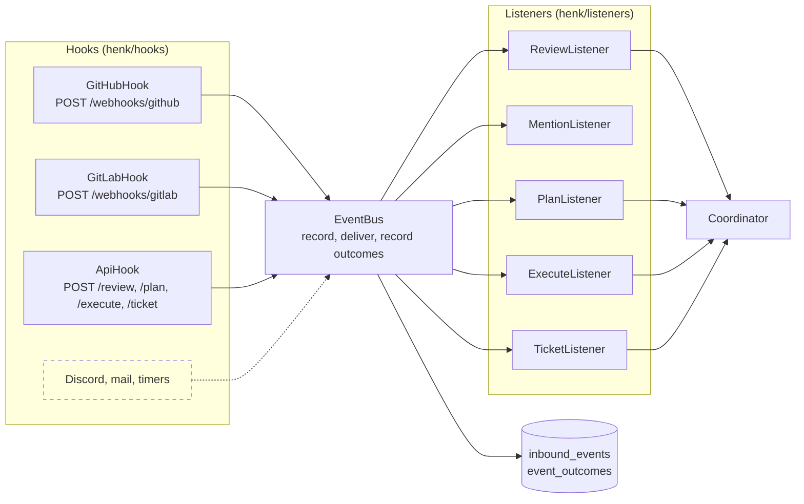

The event model (`henk-events`): `Event { id, received_at, source, kind, payload }`,
`EventSource` (GitHub webhook with delivery id, GitLab webhook, API with
requester), `EventKind` (pull request change, comment, review requested, plan
requested, execute requested, ticket requested, rebase requested, fix ci
requested (#583), a push to the default branch (#579), unmodelled, ignored) and `Handled` (ignored, started, joined,
superseded, greeted, failed with a reason). A webhook kind no parser models is
`Unmodelled` and still recorded, so a future listener can be written against
real recordings. Recordings never leave the service.

A session (`henk-session`) is the other abstraction: `SessionSpec` says what
varies (model, system prompt, opening messages, tools, limits) and the role
that runs it, and `run_session` does what every session shares (the session
row with its role, the loop, the stop mapping, the timeline line). An execute
run is one session.
A review is two `ResumableSession`s, the reviewer and the executor (only the
reviewer when it reviews alone), each resumed once per round with its own
conversation. Every session, planner, reviewer or executor, records one row
in `sessions` with its role (section 8).

## 7. Planning

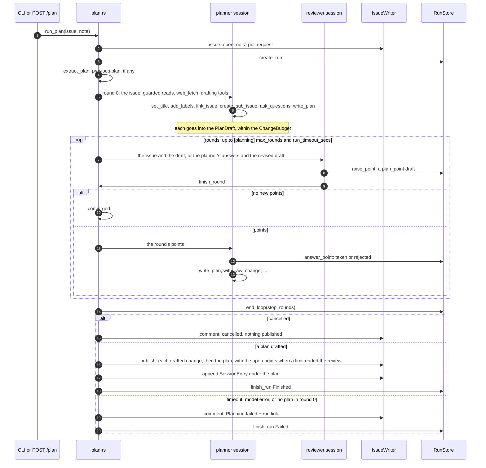

The pairing (`plan_pairing.rs`) is the review loop's alternation applied to a
plan: two `ResumableSession`s, the planner and the reviewer, each built once
with a fixed system prompt and tools. Round 0 is the planner's draft; each
round after it resumes the reviewer with the planner's answers and the
revised draft, then the planner with the round's points, so each
conversation only grows by a short update and the cached prefix holds
(#321). The pairing does not compact earlier rounds. The handoff
(`plan_review_tools.rs`) keeps the points in a `henk_domain::plan_review::
PointLedger` and on the run's drafts with the kind `plan_point`; the
planner's answers are the drafts' verdicts, `taken` or `rejected`, and a
point still unanswered when the pairing ends is `unsettled`.

Nothing reaches the tracker during the pairing. The drafting tools
(`plan_tools.rs`) put each change in a `PlanDraft`, where a title,
description, type, fields or questions replace the ones drafted before and
`withdraw_change` takes one out; the budget bounds what the draft holds.
`publish` makes the changes in a fixed order, the issue's own fields first,
then relations, sub-issues and the questions, and writes the plan last. A
change the tracker refuses is logged for the session entry; only a refused
plan fails the run.

The plan section and the session log are a region delimited by HTML comments,
parsed and rendered by `henk_domain::plan`. A drafted description keeps that
region intact; the plan keeps the session log and replaces the plan; the
session entry is appended by code after the run, never by the model.

## 7b. Taking an issue to a pull request

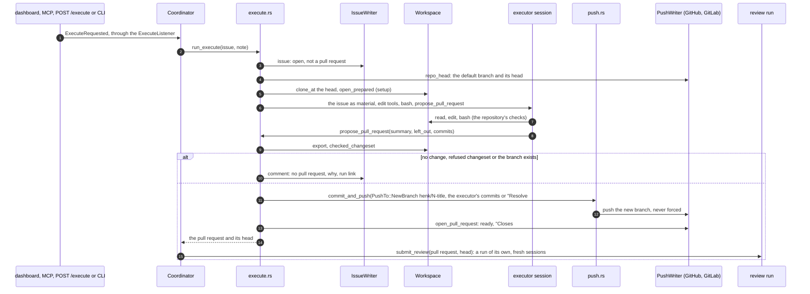

An execute run (`execute.rs`) is one `run_session` of the executor, from the
issue to its proposal, with a fixed prompt and tools (#321). Its workspace
comes from `workspace::open_prepared`, shared with the review loop: a clone
of the default branch's head, set up as the profile says. The executor's
tools are the loop's edit tools plus `propose_pull_request`
(`execute_tools.rs`), whose `commits` are checked by `commit_tools.rs` as
the loop's `propose_commits` are; nothing it holds reaches git or the platform. Henk's
code then checks the changeset, and pushes and opens as above; it runs no
checks of its own (#396). GitHub opens the pull request with `POST /repos/{repo}/pulls`;
GitLab through the `gitlab-write` MCP server's `create_merge_request`.

Henk's own pull request is reviewed because the coordinator asks for it
(`ExecuteReport::review`), not because its "opened" event gets through: that
event is still dropped as Henk's own by the filter (section 9). A run that
opens nothing ends on the issue the way a plan does (`issue_runs.rs`): one
comment for a failure or a cancel, nothing for a shutdown.

### Ticket runs

A ticket run (`ticket.rs`, #536) drives one issue through the three runs
above. It is a run of its own, kind `ticket`, with `plan`, `execute` and
`review` stages, and it links the runs it starts in `run_children`. The
`TicketListener` hands the request to `Coordinator::submit_ticket`, which
keeps one ticket run per issue and spawns `run_ticket`.

`run_ticket` calls the stages through a small seam, `Stages`: `Live` runs
`run_plan` and `run_execute` directly, with `Comments::Caller` so they end
in the store without a comment, and starts the review with
`Coordinator::submit_review_awaited`, so it goes through the slot queue and
tells the ticket run how it ended. Each step is raced against the ticket run's
cancel token and its deadline; a stage told to stop (`Coordinator::cancel`,
with `ticket:time-limit` as the canceller when the time is up) is waited for,
so it writes its own ending. Only the ticket run comments on the issue, once,
through the same `OnRun` the plan and the execute run end with.

With `[autonomous] land = true` the ticket run has a fourth stage, `land`
(`ticket/land.rs`, #637), after a passed review. It is a loop over facts, not
over events: each pass reads the pull request through `Stages::standing`
(`PushWriter::pull_standing`: GitHub's `mergeable_state`, GitLab's
`detailed_merge_status`, as one `MergeState`) and the checks through
`Stages::ci_jobs`, hands them to `henk_domain::land::decide`, and does the
one thing it answers. A rebase goes through `Coordinator::submit_rebase_awaited`
and a review through `submit_review_awaited`, so the stage waits for each and
knows how it ended; the coordinator asks for no review of a rebase whose caller
waits. Failing checks go through `Coordinator::submit_fix_ci_awaited` the same
way: the run (`fix_ci.rs`, #583) reads the checks of the head, has the executor
fix the code in a workspace and pushes a fast-forward, and the stage reviews the
head it left. What the stage knows about the head (`Ledger`: the reviewed head,
the head the last rebase left, the counts) is in memory for the length of the run.
It names only its latest child run in `run_children`; each rebase and review
is a line on the ticket run's timeline.

## 8. Run records

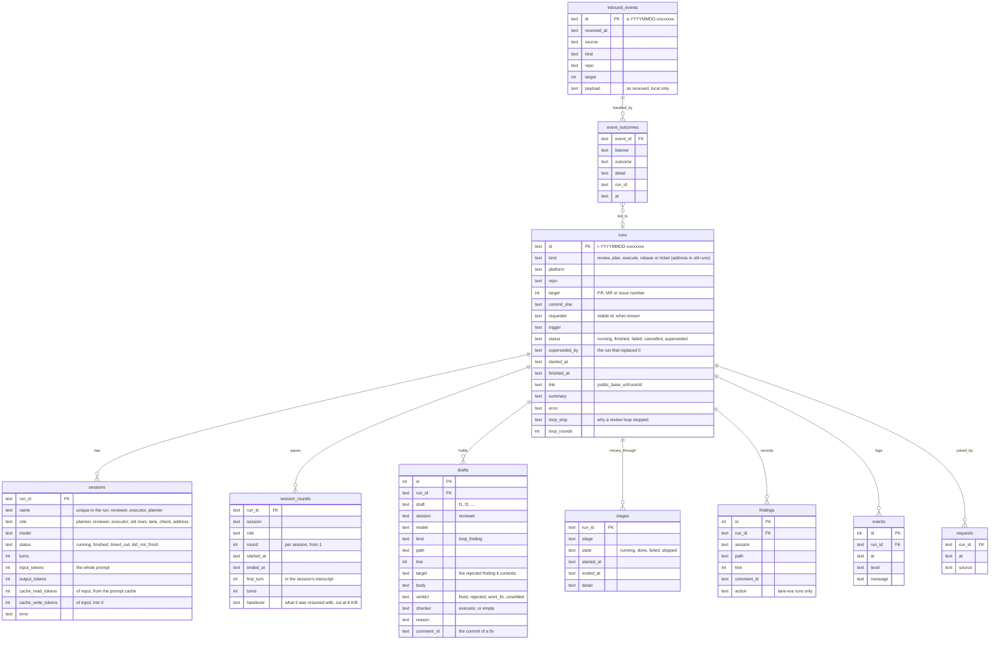

A plan records the same way: a `sessions` row for the planner and one for
the reviewer, and in `drafts` the reviewer's points with the kind `plan_point`,
where `path` is the part of the plan a point is about and `line` is 0, and
the planner's answer as the verdict (`taken`, `rejected` or `unsettled`).
`runs.loop_stop` and `loop_rounds` say why and after how many rounds its
review stopped.

An execute run with a requirements review (#535) records the same way: a
`sessions` row for the executor and one for the reviewer, the reviewer's
points as `drafts` with the kind `requirement_point` and the executor's
answer as the verdict, and `loop_stop` and `loop_rounds`. `execute_review.rs`
is the pairing: the plan pairing's points, tools and stops with the
executor answering. The reviewer reads the executor's workspace through
tools that cannot write, and a diff that Henk makes with `Checkout::diff_of`
from the exported changeset, applied to his own checkout of the default
branch each round.

A review records one `sessions` row per session (the reviewer and the
executor), its stages, and in `drafts` every finding the reviewer reported,
with the kind `loop_finding`, and the verdict it ended with: `fixed` with the
commit in `comment_id`, `rejected` or `wont_fix` by the executor, or
`unsettled` when the loop gave it one. Its `findings` stay empty, since
nothing is posted. An execution records one `sessions` row for the executor.

Each round of a pairing (a review loop's reviewer and executor, a plan's
planner and reviewer) is a `session_rounds` row (#374), written when the
role is resumed and ended when its round ends: the run page lists them in
order with what each role was handed. One-shot sessions have none.

Each session row says the role that ran it, written when the session starts
(#324); filters on tool calls and session statistics read that column, not
the name. New runs write only `planner`, `reviewer` and `executor`. Older
rows were given theirs when the `lanes` table became `sessions`: a review
lane is `lane`, a fact-check (`check-N`) is `check`, an address run's session
is `address`, and the `fixer` of a run before #323 is `executor`. The tables
and parsers keep what older runs wrote, so a lane-era run, with its lanes,
its drafts with fact-check verdicts (`confirmed`, `same_as`, `unchecked` and
the rest), its posted findings and its `lanes` and `fact_check` stages,
still reads back on the run page and in `henk runs show`.

Every comment Henk posts ends with a hidden marker
(`<!-- meneer-henk run=... model=... kind=... -->`) rendered by
`henk_domain::marker`. It is how he recognises his own words and how a
comment links back to its run (§8.1, §8.6). A review posts no comment any
more; the markers on comments of earlier reviews still parse.

## 9. Trust boundaries

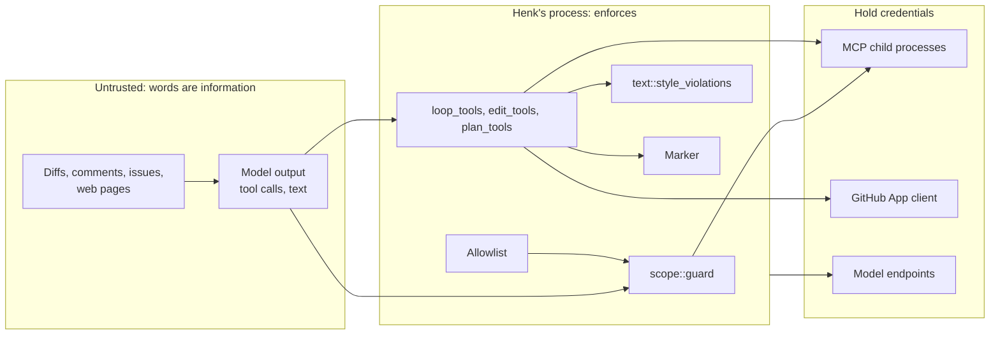

| Invariant (§8) | Enforced by |
|---|---|
| 1. Henk never triggers himself | `listeners/filter.rs`: events from bots, from Henk's own login, or whose body carries a `Marker` are rejected before any listener acts |
| 2. Henk is advisory | No write tool can approve, merge or push; `GitLabWriter::finish_review` always sets `success`; `ReviewOutcome::check_conclusion` only fails for an incomplete review |
| 3. Words are information | Prompts say so, but the code does not rely on it: every write goes through tools that validate arguments; `web_fetch` sends nothing but the URL |
| 4. The model never holds credentials | Secrets are read from the environment by `App::build`, `RmcpSession::connect` (passed to the child only), and `GitHubAuth`; the model sees tool names |
| 5. Scope is fixed per task | `scope::guard` pins repository, pull request and commit for reviews, repository and issue for plans; `plan_tools` refuse other issues except through `link_issue` |
| 6. Every visible action is traceable | `Marker` on every comment, `RunStore` for every run and every inbound event with its outcomes (events pruned after `server.keep_events_days`, runs kept), `/runs/{id}` leading to the run on the dashboard |
| 7. Allowlists bound the world | `Allowlist::allows` in `listeners/filter.rs`, `run_review` and `run_plan` |
| 8. Failure is visible | `report_failure` closes the review's check as a failure, with no comment; `run_plan` posts "Planning failed"; both record the error on the run |

The dashboard (`/dashboard`) is a second way in, for people. GitHub OAuth,
through an OAuth App and without scopes, says who someone is and nothing
more; the configured GitHub user ids decide, on every
request, whether they may look and act. It is a single-page app
(`dashboard/`, Svelte and Vite), built to static files that
`crates/henk/build.rs` embeds; `dashboard/app` serves them from memory,
behind the sign-in, with a policy that allows no inline script or style.
The app reads and acts only through the JSON API, `/dashboard/api/v1`
(`dashboard/api`, `docs/API.md`), whose actions need the session's CSRF
token in a header, the dashboard's own origin and a JSON body. Starting
work publishes the same event as the API on the same bus, so the listeners
decide as they do for any request; cancelling fires one run's token
through the coordinator, and the run ends `cancelled`. The run store Henk
writes to is wrapped in `live::Announcing`, which announces every write
the dashboard shows on this process's `live::Feed`; the API's streams
(`dashboard/api/stream`) follow the feed as Server-Sent Events, with a
replay for a reconnect and a snapshot when the replay no longer reaches
back. The app shows every value as text. The run and event links posted in comments, `/runs/{id}`
and `/events/{id}`, redirect to the dashboard's pages and so need sign-in
too; without a dashboard they are not served.

## 10. GitHub and GitLab differences

| Concern | GitHub | GitLab |
|---|---|---|
| Reads for models | `github-mcp-server` with `GITHUB_READ_ONLY=1` | `mcp-gitlab` in `readonly` mode |
| Writes | REST and GraphQL as the App (`github/api.rs`), because the MCP server's pending-review model is a per-user singleton, unsafe for concurrent writes | `mcp-gitlab` in `modify` mode with a tool allow-list, driven by `gitlab/writer.rs` |
| Review started | check run `in_progress` | award emoji on the merge request |
| Loop push | git over HTTPS with the App installation token as `x-access-token` | git over HTTPS with the personal access token as `oauth2` |
| Review ended | check `success`, `neutral` or `failure` | commit status always `success`, count in the description |
| Mention reply | reply in the review thread, or a conversation comment | reply in the discussion, or a note |
| Accounts | every installation of the App (#378): each repository's calls, git token and MCP session are its account's installation's, from the delivery's `installation.id` or `GET /repos/{owner}/{repo}/installation` | the one personal access token |

`App.github` is a `GitHubWriters`: one unscoped `GitHubApi` over a shared
`Installations` (the App key, the optional `installations` ceiling,
owner → installation, installation → token). `App::writer`, `push_writer`
and `issue_writer` take the repository and return a writer whose client is
`GitHubApi::for_repository`. Its installation is fixed for the life of the
writer, so a run cannot reach another account with its token. Tokens are
minted once per installation, held until two minutes before their
`expires_at`, and minted under a lock so concurrent calls share one.

## 11. Configuration and secrets

`henk.toml` holds ids, the allowlist, models, the roles (`[roles.planner]`,
`[roles.reviewer]`, `[roles.executor]`, #322), the review loop
(`[review.loop]`, which needs the reviewer and the executor) and the MCP
server commands.
It never holds a secret; every secret is named by the environment variable that
carries it, and the deployment fills those variables from OpenBao.

| Variable | Read by | Reaches |
|---|---|---|
| `[endpoints.*].api_key_env` | `App::build` | the clients of the endpoint's models, as a bearer token or `x-api-key` |
| `GITHUB_APP_PRIVATE_KEY_PATH` | `App::build` and, by name, the GitHub MCP child | `AppCredentials` (RS256 on ring) and the child's own token minting, as the installation Henk names in `GITHUB_APP_INSTALLATION_ID` for each session (#378) |
| `GITLAB_PERSONAL_ACCESS_TOKEN` | passed by name to both GitLab MCP children; `App::build` for the review loop's push | the children; `GitLabRest` in the `PRIVATE-TOKEN` header, and git's environment as `oauth2` Basic; never argv, a log or a model |
| `HENK_GITHUB_WEBHOOK_SECRET`, `HENK_GITLAB_WEBHOOK_TOKEN` | `server::router` | signature and token checks |
| `HENK_API_TOKEN` | `server::router` | `POST /review` and `POST /plan` |

Child processes get a cleared environment plus a short inherited list (`PATH`,
`HOME`, locale, temp) and the variables their configuration names
(`RmcpSession::connect`). A token meant for one server never reaches another.

## 12. Deployment

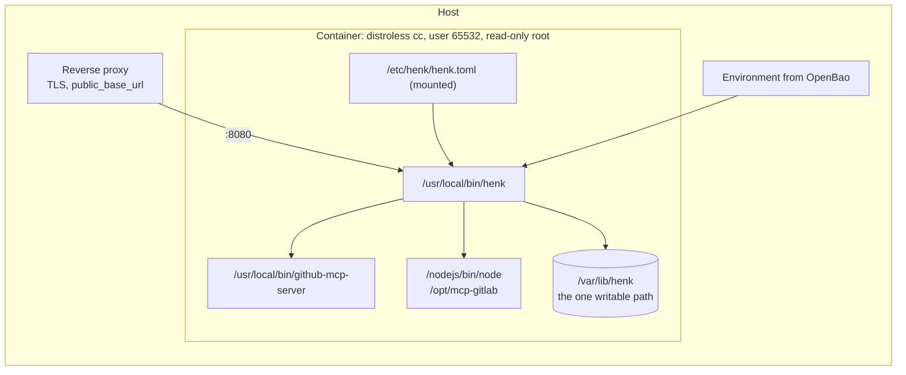

The image is built by the `Dockerfile` with a cross-compiling Rust stage, so an
arm64 image comes off an amd64 builder. `henk doctor` runs inside the container
and starts both child servers, which is the quickest way to find a missing
variable before the first webhook arrives.

## 13. Decisions and deviations

- **rmcp with a small loop of our own, not goose.** The published goose crates
  are alphas without MCP client wiring, the crate with the Agent is unpublished
  and reads global configuration, and its MCP layer is rmcp anyway. Owning the
  dispatcher is what makes §8.4 and §8.5 properties of code.
- **Hand-written model adapters.** Three wire formats cover the proxy, Anthropic,
  OpenAI and Ollama in about fifteen hundred lines, including the details an
  MCP host needs that the libraries lack: error flags on tool results,
  tool-name mapping, untouched schemas, opaque thinking blocks and reasoning
  items echoed back. OpenAI Chat Completions (`openai.rs`) is the default for
  an `openai` endpoint; `api = "responses"` uses the Responses API
  (`responses.rs`, #365), statelessly (`store: false`, encrypted reasoning
  passed back as `Block::Opaque`).
- **GitHub writes over REST.** See section 10.
- **GitLab's built-in MCP server is not used.** It is OAuth-only in its
  documentation and lacks commit statuses and award emoji; `mcp-gitlab` takes a
  personal access token and covers everything needed.
- **Provisional answers to the spec's open questions** are listed at the end of
  the README and move into `docs/SPEC.md` once confirmed.
